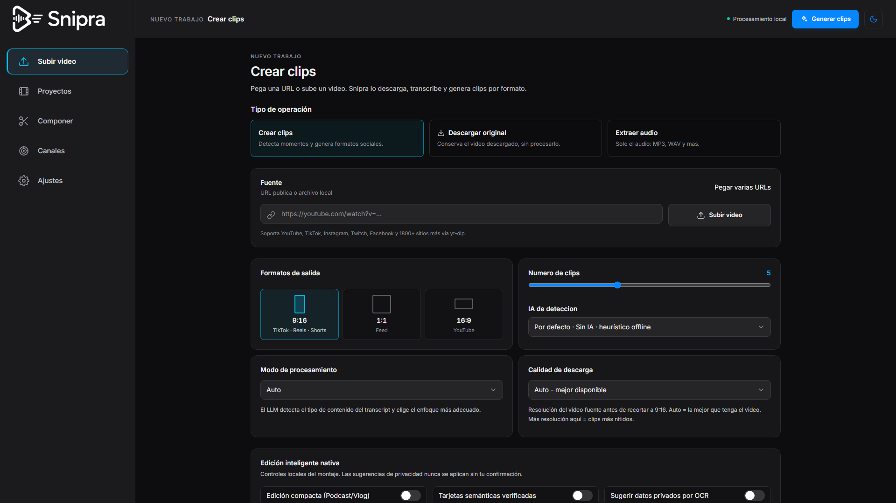
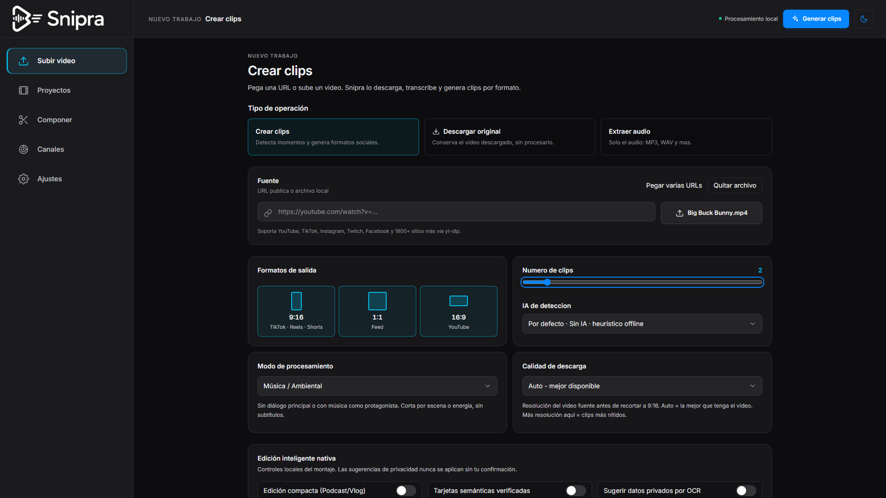
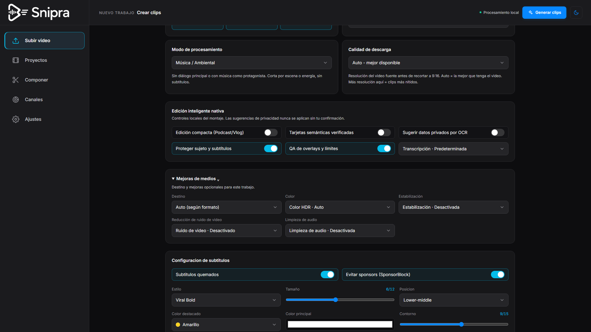
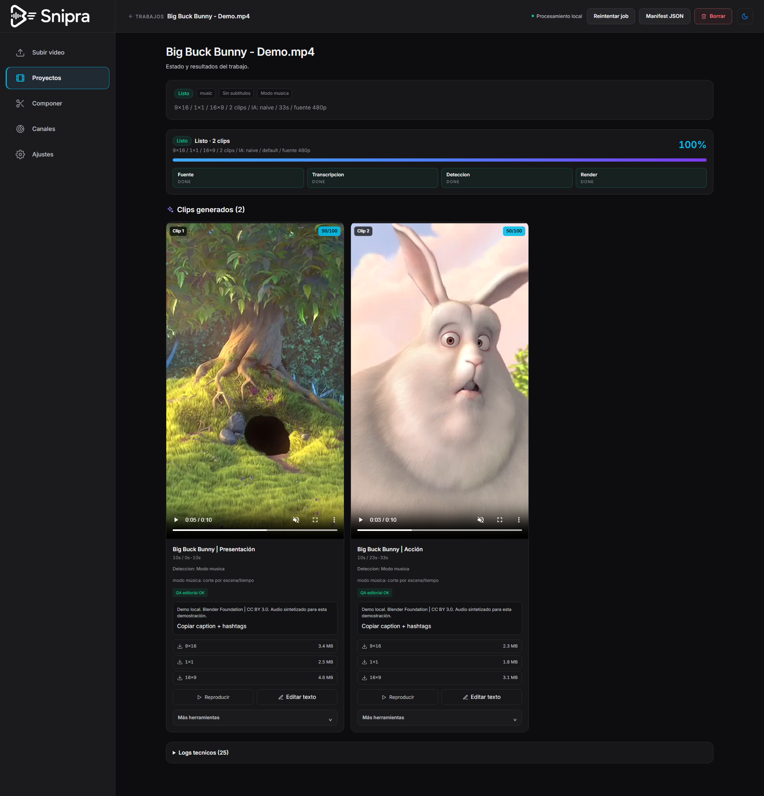
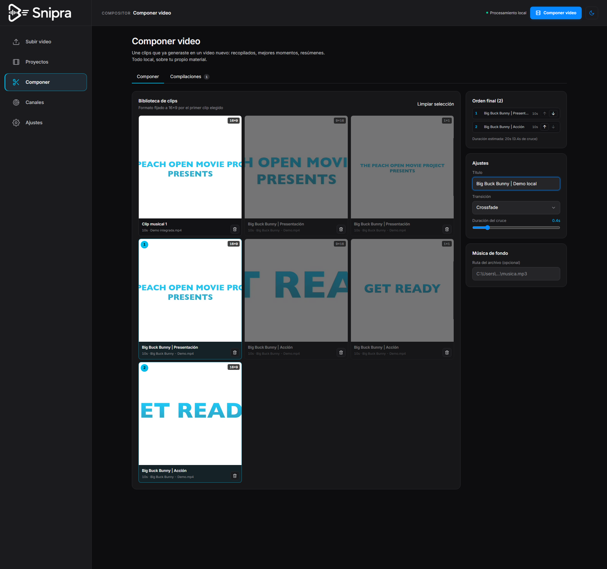
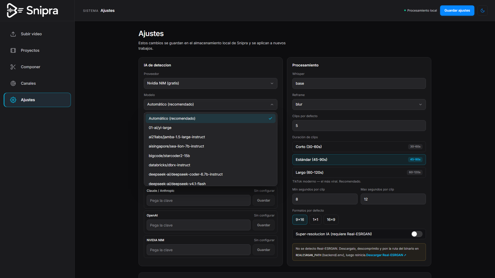
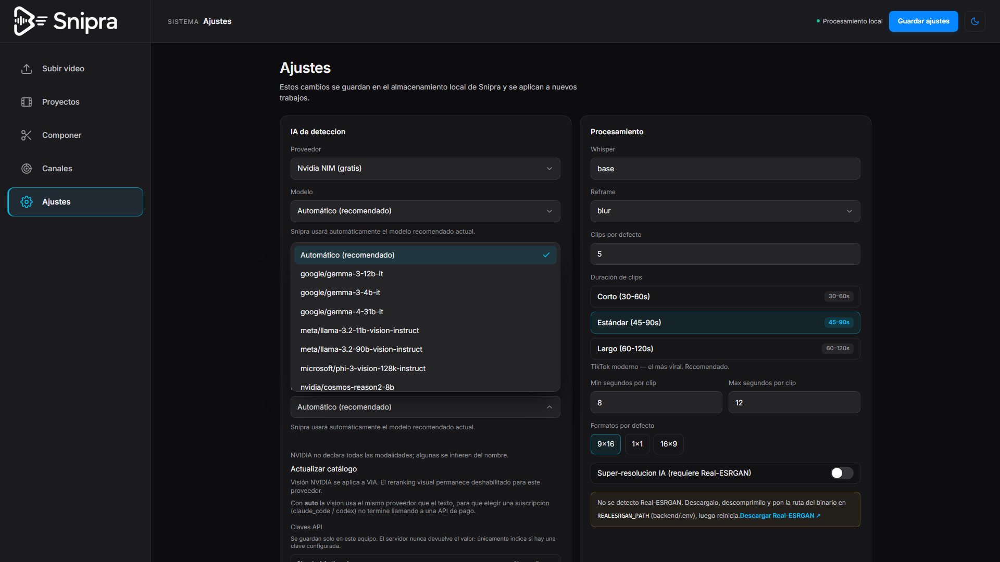

<p align="center">
  
</p>

<h1 align="center">Snipra Video</h1>

<p align="center">
  <strong>De un video a clips, composiciones y entregables, con control editorial desde tu equipo.</strong>
</p>

<p align="center">
  
  
  
</p>

<p align="center">
  <a href="#vista-previa">Capturas</a> ·
  <a href="#funcionalidades">Funcionalidades</a> ·
  <a href="#nvidia-nim-modelos-dinámicos">NVIDIA NIM</a> ·
  <a href="#plataformas-y-estado-real">Plataformas</a> ·
  <a href="#instalación-y-desarrollo">Instalación</a> ·
  <a href="#validación-y-limitaciones">Pruebas</a>
</p>

> **Snipra 1.0.0 · Código fuente público para escritorio.** La aplicación se ejecuta localmente. Aún no hay una release binaria oficial ni instaladores firmados.

Snipra es una aplicación **local-first** para importar archivos o URLs compatibles, analizar medios, producir clips en varios formatos, componer videos y revisar la calidad de salida. El procesamiento principal y los datos de trabajo residen en el equipo. Los proveedores de IA externos son **optativos** y solo se utilizan cuando se configuran y seleccionan explícitamente.

## Vista previa

Capturas de una ejecución anterior con material de demostración. Los catálogos de modelos pueden cambiar. Consulta la [galería y sus créditos](docs/screenshots/promo/README.md).

### 01 · Panel principal



### 02 · Ingesta y configuración de medios

| Ingesta de archivos | Media Foundation |
|:---:|:---:|
|  |  |

### 03 · Clips procesados



### 04 · Composición y montaje



### 05 · NVIDIA NIM: modelos de texto y visión

| Catálogo dinámico de modelos | Configuración de visión |
|:---:|:---:|
|  |  |

> Fotogramas de **Big Buck Bunny © 2008 Blender Foundation**, [CC BY 3.0](https://creativecommons.org/licenses/by/3.0/). [Créditos y fuente](docs/screenshots/promo/README.md).

## Funcionalidades

### Ingesta, descarga y procesamiento

- Importación de **archivos locales** o URLs de páginas públicas compatibles con [yt-dlp](https://github.com/yt-dlp/yt-dlp).
- Flujos para generar clips, descargar video o extraer audio, sujetos a disponibilidad y permisos del origen.
- Ejecución de trabajos en segundo plano con **API FastAPI + worker** y persistencia local en SQLite.
- Transcripción con **faster-whisper**, configuraciones de calidad y análisis editorial con reglas heurísticas locales por defecto.

### Clips, subtítulos y composición

- Extracción de momentos candidatos y exportación en **9:16, 1:1 y 16:9**.
- Reencuadre, subtítulos y opciones de personalización de entrega.
- Biblioteca de clips y **composición** con orden y transiciones.
- Motor backend de proyectos, operaciones de timeline, reedición acumulativa y versionado. **La experiencia del editor dedicado aún no se considera terminada en la navegación principal**; la captura promocional corresponde al compositor operativo.

### Media Foundation y control de entrega

- Inspección de medios: resolución, FPS y VFR, color, HDR, bit depth y características relevantes para exportación.
- Opciones de **HDR → SDR**, estabilización, reducción de ruido de video, limpieza de audio y tratamiento de subtítulos, según fuente y capacidades FFmpeg disponibles.
- Perfiles de destino y formato independientes.
- **FFmpeg Doctor** y **Delivery QC** con estados PASS/WARN/FAIL; un trabajo renderizado puede conservar advertencias reales. No se presenta un WARN como PASS.

### Extensión de navegador

- Extensión **Manifest V3** para navegadores basados en Chromium, incluidos Chrome, Edge y Brave.
- Detección de contexto de la pestaña activa y envío al backend local de la **URL de la página**, nunca de blobs o URLs CDN como sustitutos.
- Emparejamiento con aprobación humana y token local, creación de trabajos y consulta de progreso.
- Contrato **PAGE_URL_ONLY**: no intercepta streams, no descifra DRM ni garantiza disponibilidad de todos los sitios.

## NVIDIA NIM: modelos dinámicos

El selector de NVIDIA no está atado a una lista fija de modelos. Snipra consulta el catálogo del proveedor, presenta opciones compatibles de **texto y visión** y permite elegir entre:

- **Automático (recomendado):** conserva `auto` en Ajustes y resuelve un ID real al ejecutar cada tarea. Si el candidato deja de estar disponible, vuelve a evaluar el catálogo y la política.
- **Selección manual:** conserva exactamente el ID seleccionado. Si desaparece, muestra un error o aviso explícito; no cambia silenciosamente de modelo ni de proveedor.

El catálogo tiene caché local (TTL predeterminado: **5 minutos**), actualización manual y una ventana limitada para uso de caché desactualizada cuando falla la red. La política en `storage/nvidia_policy.json` es editable y se aplica sin recompilar Snipra. El modelo concreto utilizado queda registrado para trazabilidad.

**Límite importante:** NVIDIA no siempre publica metadatos suficientes para determinar si un modelo admite visión. Algunas clasificaciones se infieren y están identificadas como tales. El modo automático prioriza compatibilidad, **no garantiza el mejor modelo en calidad o latencia**. La presencia en el catálogo tampoco garantiza acceso para cada cuenta. [Diseño, caché y política](docs/NVIDIA_CATALOG.md)

## Arquitectura

```text
Archivo / URL / Extensión (PAGE_URL_ONLY)
                    │
                    ▼
          Frontend React + TypeScript
                    │
                    ▼
             API local FastAPI
                    │
             Cola / SQLite
                    │
                    ▼
           Worker de procesamiento
          ├─ yt-dlp / ingesta
          ├─ faster-whisper / transcripción
          ├─ reglas editoriales e IA opcional
          ├─ FFmpeg / clips / subtítulos
          └─ composición / Delivery QC
                    │
                    ▼
              Exportaciones locales
```

El frontend de **Windows/desarrollo** utiliza `http://localhost:5173` y la API local normalmente `127.0.0.1:8000`, con `8001` como alternativa. La extensión busca la API en ambos puertos. En el empaquetado macOS, la interfaz se sirve desde la propia API.

Toda la arquitectura técnica: [`docs/ARCHITECTURE.md`](docs/ARCHITECTURE.md).

## Plataformas y estado real

| Plataforma | Alcance |
|---|---|
| Windows | Ejecución de escritorio desde el código fuente. |
| macOS Apple Silicon | Scripts de empaquetado. Distribuir el binario requiere revisar licencias, firmar y notarizar. |
| macOS Intel y Linux | Sin distribución nativa oficial. |
| Chromium | Extensión descomprimida para Chrome, Edge y Brave con la API local activa. |

## Instalación y desarrollo

Ejecuta Snipra desde el código fuente siguiendo estos pasos.

### Windows (entorno de desarrollo)

Requisitos: Python 3.11+, [uv](https://docs.astral.sh/uv/), Node.js compatible con `package-lock.json`, FFmpeg y ffprobe en `PATH`.

```powershell
git clone https://github.com/kerwilgil/snipra-video.git
cd snipra-video
cd backend
uv sync --locked --python 3.11
cd ../frontend
npm ci
cd ..
powershell -ExecutionPolicy Bypass -File scripts/start-snipra.ps1 -NoVision -NoOpen
```

Abrir `http://localhost:5173`.

### Extensión

1. Arranca Snipra y comprueba que responde la API.
2. En Chrome, Edge o Brave, abre la página de extensiones, activa modo desarrollador y carga `extension/` como extensión descomprimida.
3. Pulsa **Conectar con Snipra** y aprueba el emparejamiento en el frontend local.

La extensión no instala el backend ni lo mantiene activo por sí sola. Más detalles en [`docs/BROWSER_EXTENSION.md`](docs/BROWSER_EXTENSION.md).

## Validación y limitaciones

Estas comprobaciones corresponden al [primer commit público](https://github.com/kerwilgil/snipra-video/commit/81e5a0322ef85370a209a029a519e187821ab72f).

| Componente | Resultado verificado |
|---|---|
| Backend | 109 pruebas dirigidas de proveedores, catálogo y robustez de VIA. Ruff aprobado. |
| Frontend | 128 pruebas, incluidas 3 de Canales. ESLint, TypeScript y build Vite aprobados. |
| Extensión | ESLint aprobado sobre la exportación. La suite anterior de 66 pruebas pasó en el código consolidado y no se repitió para esta exportación. |
| Visión opcional | Instalación del lock y prueba básica de importación en Windows. |
| Dependencias | La auditoría Python del lock para Windows y las auditorías npm de producción no reportaron avisos conocidos. Quedan avisos npm de herramientas de desarrollo. |

La página de Canales comparte un ancho máximo de 1200 px entre el resumen, el estado vacío y la lista. Su prueba lee el CSS desde el sistema de archivos para funcionar también en Windows.

El lock público incorpora `certifi 2026.10.23`, `httpx2 2.16.2`, `filelock 4.2.11` y `setuptools 84.2.1`, además de `Pillow 13.0.0` y `urllib3 2.8.0` para el extra de visión. El frontend usa `Vite 8.3.8` y `Vitest 4.1.12`. Las pruebas dirigidas no certifican un instalador ni la compatibilidad con todos los sitios y modelos externos.

### Ejecutar regresiones

```sh
# Backend (con FFmpeg/ffprobe disponibles)
cd backend
uv sync --locked --python 3.11
uv run --locked ruff check app tests
uv run --locked pytest tests -q

# Frontend
cd ../frontend
npm ci
npm test
npm run lint
npx tsc -b
npm run build

# Extensión
cd ../extension
npm ci
npm test
npm run lint
```

Las pruebas completas de medios requieren que los componentes y capacidades FFmpeg correspondientes estén disponibles. El extra `vision` es opcional para el flujo base.

## Privacidad y seguridad

- Datos, trabajos y exportaciones se almacenan localmente; los servicios del producto escuchan en **loopback**.
- Los proveedores externos de IA son opcionales. Si se activan, se transmiten al proveedor elegido los datos necesarios para la tarea.
- Los tokens y secretos de instalación no se incorporan a Git ni a las capturas. La extensión no pide permisos de `cookies` ni `webRequest`.
- Las opciones de cookies de yt-dlp son independientes de la extensión. El modo `auto` de cookies existente puede acceder a sesiones del navegador; revísalo en Ajustes si prefieres acceso público o ninguna cookie.
- El catálogo NVIDIA no debe cambiar silenciosamente de un modelo manual a otro ni consumir APIs de pago sin elección explícita.

## Tecnología

<p>
  
  
  
  
  
  
  
  
  
  
  
  
  
</p>

## Documentación y repositorios

| Recurso | Contenido |
|---|---|
| [Galería](docs/screenshots/promo/README.md) | Capturas de referencia, créditos y licencia de la demo |
| [Catálogo NVIDIA](docs/NVIDIA_CATALOG.md) | Caché, política dinámica, resolución y compatibilidad |
| [Media y arquitectura](docs/ARCHITECTURE.md) | API, pipeline, worker, editor y datos |
| [Extensión](docs/BROWSER_EXTENSION.md) | Instalación, emparejamiento y PAGE_URL_ONLY |
| [Flujo de trabajo con IA](docs/AI_WORKFLOW.md) | Evidencia y límites del desarrollo asistido |
| [Caso de estudio con IA](docs/AI_CASE_STUDY.md) | Dependencia de ejecución y aprendizaje |


Licencia del código fuente: [MIT](LICENSE). Los componentes de terceros conservan sus propias licencias.

---

<p align="center"><strong>Snipra 1.0.0 · Local-first · Código fuente público · Sin release binaria oficial</strong></p>
